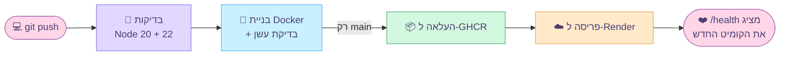

<div align="center">

<a href="README.md"></a>

<a href="https://splitship.onrender.com"></a>

<a href="https://splitship.onrender.com"></a>

<a href="https://github.com/NoyaAdivi/splitship/actions"></a>

<a href="https://github.com/NoyaAdivi/splitship/actions/workflows/ci.yml"></a>
<a href="https://github.com/NoyaAdivi/splitship/actions/workflows/deploy.yml"></a>
<a href="Dockerfile"></a>
<a href="https://nodejs.org"></a>
<a href="LICENSE"></a>

### [🚀 דמו חי](https://splitship.onrender.com) · [❤️ בדיקת תקינות](https://splitship.onrender.com/health) · [📦 אימג' Docker](https://github.com/NoyaAdivi/splitship/pkgs/container/splitship)

</div>

---

<div dir="rtl">

## 🌸 מה זה?

**SplitShip** הוא REST API קטן שמחלק חשבון מלון קבוצתי בין האורחים, מדויק עד האגורה האחרונה (בהשראת הפרויקט שלי [DiviStay](https://github.com/NoyaAdivi/DiviStay)).

הכוכב האמיתי הוא **פייפליין ה-DevOps** שמסביבו:

| | |
|---|---|
| 🐳 **Docker** | בנייה רב שלבית, מבוסס Alpine, רץ כמשתמש לא root, עם `HEALTHCHECK` מובנה |
| ✅ **בדיקות** | בדיקות יחידה ובדיקות API עם ה-test runner המובנה של Node וכיסוי קוד, על Node 20 ו-22 |
| ⚙️ **CI** | בכל push ו-PR: בדיקת תחביר, מטריצת בדיקות, בניית Docker ובדיקת עשן מול הקונטיינר הרץ |
| 📦 **Registry** | האימג' מתפרסם ב-GitHub Container Registry עם התגיות `latest` וה-SHA של הקומיט |
| ☁️ **CD** | אחרי שה-CI עובר על `main`, נשלחת פריסה ל-Render, והוורקפלואו מחכה עד ש-`/health` מחזיר את הקומיט החדש |

## 🛤️ הפייפליין

</div>



<div dir="rtl">

## 🧰 טכנולוגיות

</div>

<p align="center">
  <a href="https://nodejs.org"></a>
  <a href="https://expressjs.com"></a>
  <a href="https://www.docker.com"></a>
  <a href="https://github.com/features/actions"></a>
  <a href="https://www.linux.org"></a>
  <a href="https://render.com"></a>
</p>

<div dir="rtl">

## 🚀 הרצה

**עם Docker** (הדרך הקלה):

</div>

```bash
docker compose up --build
# open http://localhost:3000
```

<div dir="rtl">

**עם Node:**

</div>

```bash
npm install
npm test
npm start
```

<div dir="rtl">

## 🔌 ה-API

| שיטה | נתיב | מה זה עושה |
|---|---|---|
| `GET` | `/` | ממשק ווב בצבעי פסטל למחשבון |
| `GET` | `/health` | סטטוס, גרסה, SHA של הקומיט, זמן ריצה |
| `POST` | `/api/split` | חלוקת חשבון |

</div>

```bash
curl -X POST https://splitship.onrender.com/api/split \
  -H "content-type: application/json" \
  -d '{"total":1200,"mode":"nights","guests":[{"name":"Noya","nights":3},{"name":"Dana","nights":1}]}'
```
```json
{ "currency": "ILS", "mode": "nights", "total": 1200,
  "shares": [ { "name": "Noya", "amount": 900 }, { "name": "Dana", "amount": 300 } ] }
```

<div dir="rtl">

## 📁 מבנה הפרויקט

</div>

```
splitship/
├── .github/workflows/
│   ├── ci.yml          # tests + docker build + smoke test
│   └── deploy.yml      # GHCR push + Render deploy
├── src/                # Express app + split logic
├── public/             # web UI
├── test/               # unit + API tests
├── Dockerfile          # multi-stage, non-root
├── docker-compose.yml
└── render.yaml         # Render blueprint
```

<div dir="rtl">

## 🔐 הגדרת פריסה (פעם אחת)

1. ב-[Render](https://dashboard.render.com) יוצרים **Web Service** מהריפו הזה (runtime: Docker) ומכבים **Auto-Deploy**.
2. מעתיקים את ה-**Deploy Hook URL** (בהגדרות).
3. בריפו נכנסים ל-[Settings → Secrets → Actions](https://github.com/NoyaAdivi/splitship/settings/secrets/actions) ומוסיפים `RENDER_DEPLOY_HOOK_URL`.
4. ב-[Settings → Variables](https://github.com/NoyaAdivi/splitship/settings/variables/actions) מוסיפים `APP_URL` = כתובת ה-Render שלך.

</div>

---

<div align="center">

נבנה באהבה 💜 על ידי [נויה עדיבי](https://github.com/NoyaAdivi)

<a href="https://github.com/NoyaAdivi"></a>

</div>
