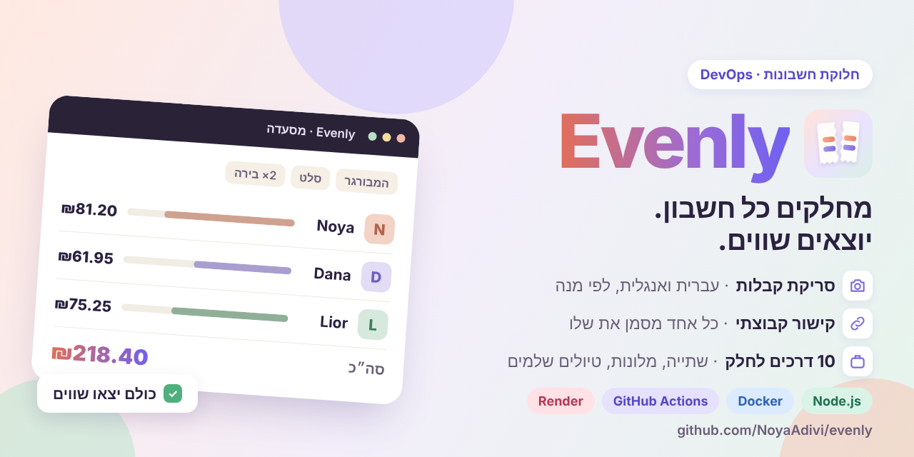
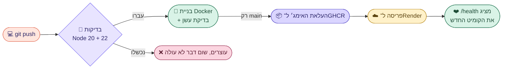

<div dir="rtl">

<p align="center">
  <a href="https://evenly.onrender.com"></a>
</p>

<p align="center"><a href="README.md"></a></p>

<p align="center">
  <a href="https://evenly.onrender.com"></a>
  <a href="https://github.com/NoyaAdivi/evenly/actions"></a>
  <a href="https://evenly.onrender.com/health"></a>
</p>

<p align="center">
  <a href="https://github.com/NoyaAdivi/evenly/actions/workflows/ci.yml"></a>
  <a href="https://github.com/NoyaAdivi/evenly/actions/workflows/deploy.yml"></a>
  <a href="LICENSE"></a>
  <a href="https://github.com/NoyaAdivi/evenly/commits/main"></a>
</p>

<h3 align="center">מחלקים כל חשבון. יוצאים שווים.</h3>

<p align="center">
  Evenly מחלק כל חשבון בין חברים, <b>מדויק עד האגורה האחרונה</b>: סורקים קבלה ממסעדה, מחלקים לפי מנה או רק את השתייה,<br>שולחים קישור שבו כל אחד מסמן את שלו, מחלקים לילות במלון או טיול שלם.<br>
  מאחורי הקלעים, כל push נבדק, נארז ב־Docker ועולה לענן לבד.
</p>

<table align="center">
  <tr>
    <td align="center" width="25%"><a href="Dockerfile"><b>🐳 Docker</b></a><br><sub>רב שלבי, בלי root</sub></td>
    <td align="center" width="25%"><a href="https://github.com/NoyaAdivi/evenly/actions/workflows/ci.yml"><b>✅ 2 × Node</b></a><br><sub>בדיקות על 20 ו־22</sub></td>
    <td align="center" width="25%"><a href="https://github.com/NoyaAdivi/evenly/pkgs/container/evenly"><b>📦 GHCR</b></a><br><sub>אימג׳ לכל קומיט</sub></td>
    <td align="center" width="25%"><a href="https://evenly.onrender.com"><b>☁️ פריסה אוטומטית</b></a><br><sub>ל־Render אחרי ה־CI</sub></td>
  </tr>
</table>

<p align="center">
  <a href="https://evenly.onrender.com"></a>
</p>

<a name="what"></a>
<p align="center"><a href="#pipeline"></a></p>

<table dir="rtl">
  <tr valign="top">
    <td valign="top" width="33%" dir="rtl">
      <p><b>🐳 ארוז ב־Docker</b></p>
      <ul>
        <li><a href="Dockerfile"><b>בנייה רב שלבית</b></a> על Alpine, אימג׳ קטן</li>
        <li><b>רץ בלי הרשאות root</b></li>
        <li><b>HEALTHCHECK מובנה</b> על <code>/health</code></li>
        <li><a href="docker-compose.yml"><b>docker compose up</b></a> וזה רץ</li>
      </ul>
    </td>
    <td valign="top" width="33%" dir="rtl">
      <p><b>✅ נבדק בכל push</b></p>
      <ul>
        <li><a href="test"><b>בדיקות יחידה ו־API</b></a> עם ה־test runner המובנה של Node</li>
        <li><b>מטריצה</b> על Node 20 ו־22, עם כיסוי קוד</li>
        <li><b>בדיקת עשן</b> מול הקונטיינר האמיתי כשהוא רץ</li>
        <li>בדיקה שנכשלת <b>עוצרת את הפריסה</b></li>
      </ul>
    </td>
    <td valign="top" width="33%" dir="rtl">
      <p><b>☁️ עולה לענן לבד</b></p>
      <ul>
        <li><a href="https://github.com/NoyaAdivi/evenly/pkgs/container/evenly"><b>האימג׳ עולה ל־GHCR</b></a> עם התגיות <code>latest</code> וה־SHA</li>
        <li><b>פריסה ל־Render</b> רק אחרי שה־CI עובר</li>
        <li><b>מוודא שהגרסה עלתה:</b> מחכה ש־<code>/health</code> יציג את הקומיט החדש</li>
        <li><a href="https://evenly.onrender.com"><b>ממשק ווב בפסטל</b></a> לנסות בדפדפן</li>
      </ul>
    </td>
  </tr>
</table>

<a name="app"></a>
<h3 align="center">📲 אפליקציה ושאלות נפוצות <sub><sup>חדש</sup></sub></h3>
<p align="center">אפשר להתקין את Evenly כאפליקציה אמיתית עם אייקון משלה, והאתר עונה על השאלות הנפוצות לפי נושא.</p>

<table>
  <tr valign="top">
    <td width="50%">
      <ul>
        <li><b>📲 אפליקציה להתקנה (PWA):</b> אייקון וחלון משלה בטלפון ובמחשב, עם השם Evenly בלבד</li>
        <li><b>⚡ עובדת גם בלי אינטרנט</b> אחרי הביקור הראשון, בעזרת Service Worker</li>
      </ul>
    </td>
    <td width="50%">
      <ul>
        <li><b><a href="https://evenly.onrender.com/?lang=he#faq">❓ שאלות נפוצות לפי נושא</a>:</b> סינון בצ׳יפים, חיפוש עם הדגשה ואנימציות רכות</li>
        <li><b>🔗 נבנה על ידי נויה אדיבי</b> עם קישור ללינקדאין בתחתית כל עמוד</li>
      </ul>
    </td>
  </tr>
</table>


<a name="pipeline"></a>
<p align="center"><a href="#tech-stack"></a></p>

</div>



<div dir="rtl">

<p align="center"><sub>הוורקפלואים: <a href=".github/workflows/ci.yml">ci.yml</a> · <a href=".github/workflows/deploy.yml">deploy.yml</a></sub></p>

<a name="tech-stack"></a>
<p align="center"><a href="#api"></a></p>

<p align="center"><b>אפליקציה</b><br>
<a href="https://nodejs.org"></a>
<a href="https://expressjs.com"></a>
</p>

<p align="center"><b>קונטיינר</b><br>
<a href="https://www.docker.com"></a>
<a href="https://alpinelinux.org"></a>
<a href="https://github.com/NoyaAdivi/evenly/pkgs/container/evenly"></a>
</p>

<p align="center"><b>CI / CD</b><br>
<a href="https://github.com/NoyaAdivi/evenly/actions"></a>
<a href="https://nodejs.org/api/test.html"></a>
</p>

<p align="center"><b>ענן</b><br>
<a href="https://render.com"></a>
</p>

<a name="api"></a>
<p align="center"><a href="#run-locally"></a></p>

| שיטה | נתיב | מה זה עושה |
|---|---|---|
| `GET` | [`/`](https://evenly.onrender.com) | ממשק ווב פסטלי עם 10 דרכים לחלק: סריקת קבלה, לפי מנה, אוכל ושתייה, קישור קבוצתי, שווה, אחוזים, חלקים, סכומים מדויקים, לילות במלון והוצאות טיול |
| `GET` | [`/health`](https://evenly.onrender.com/health) | סטטוס, גרסה, SHA של הקומיט, זמן ריצה |
| `POST` | `/api/split` | חלוקת חשבון: שווה (`equal`), לילות (`nights`), לפי מנות (`items`), אחוזים (`percent`), חלקים (`shares`), סכומים מדויקים (`exact`) או קטגוריות (`pools`, למשל שתייה רק בין מי ששתה), עם טיפ (`tipPercent`), יום הולדת (`treat`, האחרים משלמים עליו) ועיגול (`roundTo`, בלי מטבעות) |
| `POST` | `/api/settle` | הוצאות טיול עם כמה משלמים, להכי מעט העברות (מי מעביר למי) |
| `POST` | `/api/receipt/parse` | הופך טקסט של קבלה סרוקה (עברית או אנגלית) למנות עם קטגוריה, סכום ודמי שירות |
| `POST` | `/api/rooms` | פתיחת קישור קבוצתי (נשמר 24 שעות בזיכרון) |
| `GET` | `/api/rooms/:id` | מצב חי: מנות, מי סימן מה, וסכומים |
| `POST` | `/api/rooms/:id/claim` | חבר מסמן מנה כשלו (`/join` מוסיף שם) |

</div>

```bash
curl -X POST https://evenly.onrender.com/api/split \
  -H "content-type: application/json" \
  -d '{"total":1200,"mode":"nights","guests":[{"name":"Noya","nights":3},{"name":"Dana","nights":1}]}'
```
```json
{ "currency": "ILS", "mode": "nights", "total": 1200,
  "shares": [ { "name": "Noya", "amount": 900 }, { "name": "Dana", "amount": 300 } ] }
```

<div dir="rtl">

<a name="run-locally"></a>
<p align="center"><a href="#deploy-setup"></a></p>

**עם Docker:**

</div>

```bash
docker compose up --build
# open http://localhost:3000
```

<div dir="rtl">

**עם Node 20 ומעלה:**

</div>

```bash
npm install
npm test
npm start
```

<div dir="rtl">

<a name="deploy-setup"></a>
<p align="center"><a href="#contact"></a></p>

1. ב־[Render](https://dashboard.render.com) יוצרים **Web Service** מהריפו הזה, בשפה **Docker**, ומכבים את **Auto-Deploy**.
2. מעתיקים את כתובת ה־**Deploy Hook** מההגדרות של השירות.
3. מוסיפים אותה כ־Secret בשם `RENDER_DEPLOY_HOOK_URL` ב־[Settings → Secrets → Actions](https://github.com/NoyaAdivi/evenly/settings/secrets/actions).
4. מוסיפים את כתובת ה־Render כ־Variable בשם `APP_URL` ב־[Settings → Variables → Actions](https://github.com/NoyaAdivi/evenly/settings/variables/actions).

> [!IMPORTANT]
> כתובת ה־Deploy Hook היא סוד. שומרים אותה רק ב־GitHub Secrets, אף פעם לא בקוד.

<details>
<summary><b>📂 מבנה הפרויקט</b></summary>

</div>

```
├── .github/workflows/
│   ├── ci.yml          בדיקות על Node 20 ו־22, בניית Docker, בדיקת עשן
│   └── deploy.yml      העלאה ל־GHCR, פריסה ל־Render, המתנה ל־/health
├── src/
│   ├── split.js        לוגיקת החלוקה (מדויק עד האגורה)
│   ├── app.js          אפליקציית Express והנתיבים
│   └── server.js       נקודת הכניסה עם כיבוי מסודר
├── public/             ממשק ווב בפסטל
├── test/               בדיקות יחידה ו־API
├── docs/               עיצובי README ותמונות שיתוף
├── Dockerfile          רב שלבי, בלי root, עם HEALTHCHECK
├── docker-compose.yml
└── render.yaml         הגדרות Render
```

<div dir="rtl">
</details>

<a name="contact"></a>
<p align="center"><a href="https://www.linkedin.com/in/noya-adivi/"></a></p>

<p align="center">
  <a href="https://evenly.onrender.com"></a>
  <a href="https://www.linkedin.com/in/noya-adivi/"></a>
  <a href="https://noyaadivi.github.io/noya-website"></a>
  <a href="https://github.com/NoyaAdivi"></a>
</p>

</div>
