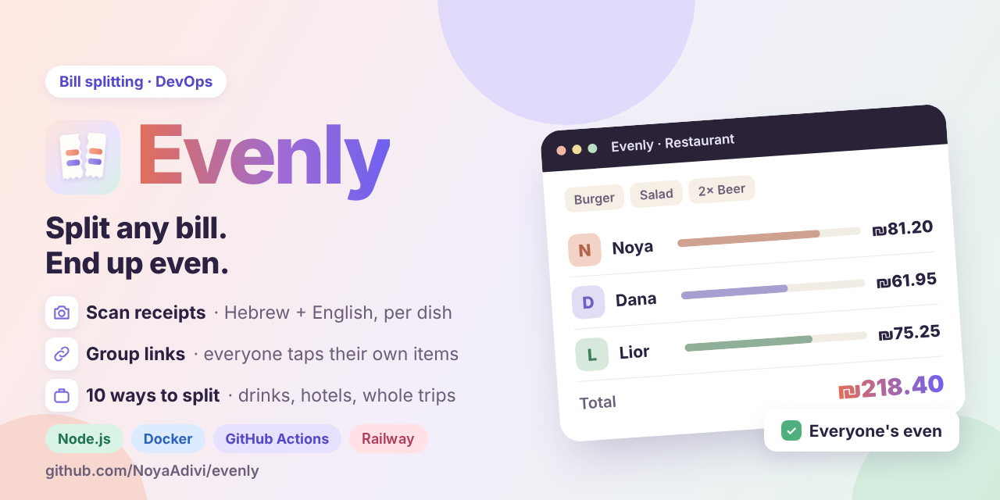
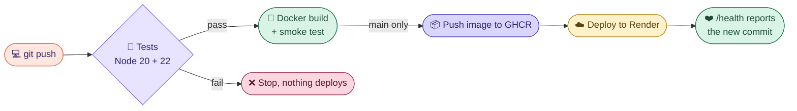

<p align="center">
  <a href="https://evenly-app.onrender.com"></a>
</p>

<p align="center"><a href="README.he.md"></a></p>

<p align="center">
  <a href="https://evenly-app.onrender.com"></a>
  <a href="https://github.com/NoyaAdivi/evenly/actions"></a>
  <a href="https://evenly-app.onrender.com/health"></a>
</p>

<p align="center">
  <a href="https://github.com/NoyaAdivi/evenly/actions/workflows/ci.yml"></a>
  <a href="https://github.com/NoyaAdivi/evenly/actions/workflows/deploy.yml"></a>
  <a href="LICENSE"></a>
  <a href="https://github.com/NoyaAdivi/evenly/commits/main"></a>
</p>

<h3 align="center">Split any bill. End up even.</h3>

<p align="center">
  Evenly splits any bill between friends, <b>exactly to the last agora</b>: scan a restaurant receipt, split per dish or just the drinks,<br>send a group link where everyone taps their own items, split hotel nights or a whole trip.<br>
  Under the hood, every push is tested, containerized and deployed to the cloud on its own.
</p>

<table align="center">
  <tr>
    <td align="center" width="25%"><a href="Dockerfile"><b>🐳 Docker</b></a><br><sub>multi-stage, non-root</sub></td>
    <td align="center" width="25%"><a href="https://github.com/NoyaAdivi/evenly/actions/workflows/ci.yml"><b>✅ 2 × Node</b></a><br><sub>tests on 20 and 22</sub></td>
    <td align="center" width="25%"><a href="https://github.com/NoyaAdivi/evenly/pkgs/container/evenly"><b>📦 GHCR</b></a><br><sub>image tagged per commit</sub></td>
    <td align="center" width="25%"><a href="https://evenly-app.onrender.com"><b>☁️ Auto deploy</b></a><br><sub>to Render after CI</sub></td>
  </tr>
</table>

<p align="center">
  <a href="https://evenly-app.onrender.com"></a>
</p>

<a name="what"></a>
<p align="center"><a href="#pipeline"></a></p>

<table>
  <tr valign="top">
    <td valign="top" width="33%">
      <p><b>🐳 Containerized</b></p>
      <ul>
        <li><a href="Dockerfile"><b>Multi-stage build</b></a> on Alpine, small image</li>
        <li><b>Runs as non-root</b> user</li>
        <li><b>Built-in HEALTHCHECK</b> on <code>/health</code></li>
        <li><a href="docker-compose.yml"><b>docker compose up</b></a> and it runs</li>
      </ul>
    </td>
    <td valign="top" width="33%">
      <p><b>✅ Tested on every push</b></p>
      <ul>
        <li><a href="test"><b>Unit and API tests</b></a> with Node's built-in runner</li>
        <li><b>Matrix</b> on Node 20 and 22, with coverage</li>
        <li><b>Smoke test</b> against the real running container</li>
        <li>A failed test <b>stops the deploy</b></li>
      </ul>
    </td>
    <td valign="top" width="33%">
      <p><b>☁️ Deploys itself</b></p>
      <ul>
        <li><a href="https://github.com/NoyaAdivi/evenly/pkgs/container/evenly"><b>Image pushed to GHCR</b></a>, tagged <code>latest</code> and per commit</li>
        <li><b>Render deploy</b> triggered only after CI passes</li>
        <li><b>Verifies the release</b>: waits until <code>/health</code> shows the new commit</li>
        <li><a href="https://evenly-app.onrender.com"><b>Pastel web UI</b></a> to try it in the browser</li>
      </ul>
    </td>
  </tr>
</table>

<a name="pipeline"></a>
<p align="center"><a href="#tech-stack"></a></p>



<p align="center"><sub>Workflows: <a href=".github/workflows/ci.yml">ci.yml</a> · <a href=".github/workflows/deploy.yml">deploy.yml</a></sub></p>

<a name="tech-stack"></a>
<p align="center"><a href="#api"></a></p>

<p align="center"><b>App</b><br>
<a href="https://nodejs.org"></a>
<a href="https://expressjs.com"></a>
</p>

<p align="center"><b>Container</b><br>
<a href="https://www.docker.com"></a>
<a href="https://alpinelinux.org"></a>
<a href="https://github.com/NoyaAdivi/evenly/pkgs/container/evenly"></a>
</p>

<p align="center"><b>CI / CD</b><br>
<a href="https://github.com/NoyaAdivi/evenly/actions"></a>
<a href="https://nodejs.org/api/test.html"></a>
</p>

<p align="center"><b>Cloud</b><br>
<a href="https://render.com"></a>
</p>

<a name="api"></a>
<p align="center"><a href="#run-locally"></a></p>

| Method | Path | What it does |
|---|---|---|
| `GET` | [`/`](https://evenly-app.onrender.com) | Pastel web UI with 10 ways to split: receipt scan, per dish, food & drinks, group link, equally, percent, shares, exact amounts, hotel nights, trip expenses |
| `GET` | [`/health`](https://evenly-app.onrender.com/health) | Status, version, commit SHA, uptime |
| `POST` | `/api/split` | Split a bill: `equal`, `nights` (hotel), `items` (per dish), `percent`, `shares`, `exact` or `pools` (food, drinks, taxi... each split only between its people), with optional `tipPercent`, `treat` (birthday: others pay for them) and `roundTo` (round shares up, no coins) |
| `POST` | `/api/settle` | Trip expenses with several payers to the fewest transfers (who pays whom) |
| `POST` | `/api/receipt/parse` | Turn scanned receipt text (Hebrew or English) into dishes with categories, total and service charge |
| `POST` | `/api/rooms` | Open a group link (lives 24h in memory) |
| `GET` | `/api/rooms/:id` | Live room: items, who claimed what, totals |
| `POST` | `/api/rooms/:id/claim` | A friend taps an item as theirs (`/join` adds a name) |

```bash
curl -X POST https://evenly-app.onrender.com/api/split \
  -H "content-type: application/json" \
  -d '{"total":1200,"mode":"nights","guests":[{"name":"Noya","nights":3},{"name":"Dana","nights":1}]}'
```
```json
{ "currency": "ILS", "mode": "nights", "total": 1200,
  "shares": [ { "name": "Noya", "amount": 900 }, { "name": "Dana", "amount": 300 } ] }
```

<a name="run-locally"></a>
<p align="center"><a href="#deploy-setup"></a></p>

**With Docker:**
```bash
docker compose up --build
# open http://localhost:3000
```

**With Node 20+:**
```bash
npm install
npm test
npm start
```

<a name="deploy-setup"></a>
<p align="center"><a href="#contact"></a></p>

1. On [Render](https://dashboard.render.com) create a **Web Service** from this repo, language **Docker**, and turn **Auto-Deploy off**.
2. Copy the service's **Deploy Hook** URL from its settings.
3. Add it as the secret `RENDER_DEPLOY_HOOK_URL` in [Settings → Secrets → Actions](https://github.com/NoyaAdivi/evenly/settings/secrets/actions).
4. Add your Render address as the variable `APP_URL` in [Settings → Variables → Actions](https://github.com/NoyaAdivi/evenly/settings/variables/actions).

> [!IMPORTANT]
> The deploy hook URL is a secret. Keep it only in GitHub Secrets, never in the code.

<details>
<summary><b>📂 Project structure</b></summary>

```
├── .github/workflows/
│   ├── ci.yml          tests on Node 20 + 22, Docker build, smoke test
│   └── deploy.yml      push image to GHCR, deploy to Render, wait for /health
├── src/
│   ├── split.js        the splitting logic (exact to the agora)
│   ├── app.js          Express app and routes
│   └── server.js       entry point with graceful shutdown
├── public/             pastel web UI
├── test/               unit + API tests (node:test)
├── docs/               README art and social images
├── Dockerfile          multi-stage, non-root, HEALTHCHECK
├── docker-compose.yml
└── render.yaml         Render blueprint
```
</details>

<a name="contact"></a>
<p align="center"><a href="https://www.linkedin.com/in/noya-adivi/"></a></p>

<p align="center">
  <a href="https://evenly-app.onrender.com"></a>
  <a href="https://www.linkedin.com/in/noya-adivi/"></a>
  <a href="https://noyaadivi.github.io/noya-website"></a>
  <a href="https://github.com/NoyaAdivi"></a>
</p>
