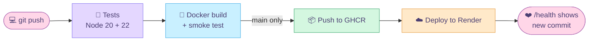

<div align="center">

<a href="README.he.md"></a>

<a href="https://splitship.onrender.com"></a>

<a href="https://splitship.onrender.com"></a>

<a href="https://github.com/NoyaAdivi/splitship/actions"></a>

<a href="https://github.com/NoyaAdivi/splitship/actions/workflows/ci.yml"></a>
<a href="https://github.com/NoyaAdivi/splitship/actions/workflows/deploy.yml"></a>
<a href="Dockerfile"></a>
<a href="https://nodejs.org"></a>
<a href="LICENSE"></a>

### [🚀 Live demo](https://splitship.onrender.com) · [❤️ Health check](https://splitship.onrender.com/health) · [📦 Docker image](https://github.com/NoyaAdivi/splitship/pkgs/container/splitship)

</div>

---

## 🌸 What is this?

**SplitShip** is a small REST API that splits a group hotel bill between guests, exactly to the last agora (inspired by my project [DiviStay](https://github.com/NoyaAdivi/DiviStay)).

The real star is the **DevOps pipeline** around it:

| | |
|---|---|
| 🐳 **Docker** | Multi-stage, Alpine based, runs as a non-root user, built-in `HEALTHCHECK` |
| ✅ **Tests** | Unit + API tests with Node's built-in test runner and coverage, on Node 20 and 22 |
| ⚙️ **CI** | Every push and PR: lint, test matrix, Docker build and a smoke test against the running container |
| 📦 **Registry** | Image is published to GitHub Container Registry, tagged `latest` and with the commit SHA |
| ☁️ **CD** | After CI passes on `main`, Render is triggered to deploy, then the workflow waits until `/health` reports the new commit |

## 🛤️ The pipeline



## 🧰 Tech stack

<p align="center">
  <a href="https://nodejs.org"></a>
  <a href="https://expressjs.com"></a>
  <a href="https://www.docker.com"></a>
  <a href="https://github.com/features/actions"></a>
  <a href="https://www.linux.org"></a>
  <a href="https://render.com"></a>
</p>

## 🚀 Run it

**With Docker** (the easy way):
```bash
docker compose up --build
# open http://localhost:3000
```

**With Node:**
```bash
npm install
npm test
npm start
```

## 🔌 API

| Method | Path | What it does |
|---|---|---|
| `GET` | `/` | Pastel web UI for the calculator |
| `GET` | `/health` | Status, version, commit SHA, uptime |
| `POST` | `/api/split` | Split a bill |

```bash
curl -X POST https://splitship.onrender.com/api/split \
  -H "content-type: application/json" \
  -d '{"total":1200,"mode":"nights","guests":[{"name":"Noya","nights":3},{"name":"Dana","nights":1}]}'
```
```json
{ "currency": "ILS", "mode": "nights", "total": 1200,
  "shares": [ { "name": "Noya", "amount": 900 }, { "name": "Dana", "amount": 300 } ] }
```

## 📁 Project structure

```
splitship/
├── .github/workflows/
│   ├── ci.yml          # tests + docker build + smoke test
│   └── deploy.yml      # GHCR push + Render deploy
├── src/                # Express app + split logic
├── public/             # web UI
├── test/               # unit + API tests
├── Dockerfile          # multi-stage, non-root
├── docker-compose.yml
└── render.yaml         # Render blueprint
```

## 🔐 Deploy setup (one time)

1. On [Render](https://dashboard.render.com) create a **Web Service** from this repo (runtime: Docker), turn **Auto-Deploy off**.
2. Copy its **Deploy Hook URL** (Settings).
3. In this repo go to [Settings → Secrets → Actions](https://github.com/NoyaAdivi/splitship/settings/secrets/actions) and add `RENDER_DEPLOY_HOOK_URL`.
4. In [Settings → Variables](https://github.com/NoyaAdivi/splitship/settings/variables/actions) add `APP_URL` = your Render URL.

---

<div align="center">

Made with 💜 by [Noya Adivi](https://github.com/NoyaAdivi)

<a href="https://github.com/NoyaAdivi"></a>

</div>
